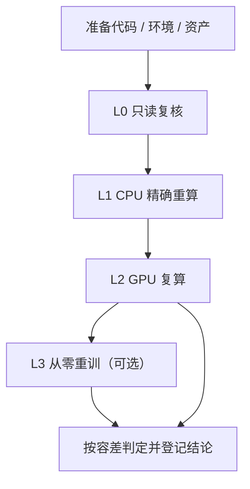

# 复现指南（C-01 – C-35）

> 适用仓库：`https://github.com/yichen-2025/Multimodal-Fusion-Model`，分支 `exp/explain-rag`
> 结论登记处：`docs/claims.md`（v2.9，C-01–C-35）
> 本文件只说明"如何复现"：从零准备环境与资产、逐层重算、按容差判定。不包含实验设计、写作建议和开发过程记录。

## 0. 复现范围与方式

### 0.1 这个项目在研究什么

一句话：在 CSE-CIC-IDS2017 子集上，把每条流量样本的 79 维数值特征与一段由这些字段生成的模板文本一起输入模型，比较 LLM 编码器（Qwen2.5-1.5B + LoRA）与 BERT 编码器在开集入侵检测上的表现，并诊断文本模态是否提供数值特征之外的独立信息。

复现的目标不是重写论文，而是验证 `docs/claims.md` 里登记的每条数值结论，能否由仓库中的代码与产物重新算出来。

### 0.2 复现由哪些组件构成

先分清"代码"和"产物"：代码在 git 里，数据和模型产物大部分不在 git 里，需要按下面的来源获取。

| 组件 | 在项目里是什么 | 由谁产生 | 获取方式 | 何时需要 |
|---|---|---|---|---|
| `scripts/`、`src/`、`utils/` | 训练、评测、审计脚本 | 仓库 | `git clone` | 全程 |
| `split_data/dataset_200/split_openset_0/` | train/val/test = 6362/960/2040，含数值特征、模板文本、BERT 嵌入 | 数据管线 | Release `split_openset_0.tar.gz` | L1 起；不要自行重生成，行序会变 |
| `emb/` | BERT/Qwen1.5B/Qwen7B 的文本嵌入与类原型 | `cache_text_embeddings.py`、`build_semantic_prototypes.py` | 已入库 | C-20/C-29/C-35 |
| `saved_models/` | 训练后的 backbone（A0\*、A3 等） | `train.py` | 未发布，向作者索取或按 §8 重训 | C-01/C-02/C-12/C-21 |
| `saved_ood_heads/` | 在 backbone 特征上训练的 OOD 判别头 | `train_ood_head.py` | Release `saved_ood_heads.tar.gz` | C-03–C-10 等 |
| `ood_reports/` | 每条测试样本的 OOD 分数与判定 | `run_ood_routing.py` | Release `ood_reports.tar.gz` | 开集路由链 |
| `models/bert`、`models/qwen2.5-1.5b` | 公开预训练权重 | 公开模型 | `tools/download_bert.py`、`tools/download_qwen.py` | L2 起 |
| `explanation_results/` | LLM 解释文本与评测 JSON | `generate_*_explanations.py`、`eval_*` | 未发布，向作者索取或按 §7.3 重生成 | C-11、C-13–C-16 |
| `test_reports/` | 各模型的闭集指标报告 | `test_model.py` | 未发布，向作者索取或按 §7.1 重跑 | C-01/C-02 |
| `results/2026-*` | 论文引用的冻结指标 | 历史运行输出 | 已入库，只读 | 全部判定 |
| `artifacts/ledger.csv` | 产物状态（active / deprecated） | `audit_artifacts.py` | 已入库 | C-09 等 |

未发布的原因通常是体积与审计成本。缺失时只能降级处理：重训或重生成得到的是"同名替代产物"，不能声称与原产物逐位一致。

### 0.3 哪些结论可以复现

| 类别 | 结论 | 复现方式 |
|---|---|---|
| 脚本可复现（29 条） | C-01–C-16、C-19–C-25、C-28–C-30、C-33–C-35 | 按 §5–§8 执行命令，与冻结值比对 |
| 不在论文范围（3 条） | C-17、C-26、C-27（人工盲评支线） | 不纳入本文复现范围 |
| 尚无实验（3 条） | C-18、C-31、C-32 | 无法复现，只能登记为"待检验" |

说明：人工盲评支线不在论文内，本文不提供其复现步骤；C-17/C-26/C-27 仅在 `docs/claims.md` 中保留仓库记录。C-29、C-30 未列入 `claims.md` 主表，定义见该文件 §5.3、§5.4。

复现分四级，级别越高对硬件与资产要求越高：

| 级别 | 含义 | 判定容差 | 依赖 |
|---|---|---|---|
| L0 只读复核 | 读已入库 JSON/CSV/台账，重算统计量 | 数值 1e-2 或逐位 | git 仓库 |
| L1 精确复现 | 同数据、同代码、同 seed 重算 | 1e-9 | git + Release 数据包 |
| L2 GPU 复算 | 用已训模型/已发布报告重算或重新生成 | 比值 ±25%（延迟类）；其余同 L1 | 资产 + GPU + 基座权重 |
| L3 从零重训 | 重新训练 backbone / OOD 头 / 消融 | 方向一致，数值允许 seed 波动 | GPU + GPU 时长 |



### 0.4 最小上手路径（约 30 分钟，无需 GPU）

第一次接触时不要通读全部命令，先跑通下面这条最小路径，确认环境与数据没问题：

```bash
# 1) 代码
git clone -b exp/explain-rag https://github.com/yichen-2025/Multimodal-Fusion-Model.git
cd Multimodal-Fusion-Model

# 2) 把三个 Release 包与 SHA256SUMS 放到仓库根目录后
sha256sum -c SHA256SUMS
mkdir -p split_data/dataset_200
tar -xzf split_openset_0.tar.gz -C split_data/dataset_200/
tar -xzf ood_reports.tar.gz -C .
tar -xzf saved_ood_heads.tar.gz -C .

# 3) 环境（详见 §3）
conda create -n mf python=3.12 -y && conda activate mf
pip install -r requirements.txt
pip install "numpy==2.3.2" "scikit-learn==1.9.0"

# 4) 最小验证
python scripts/verify_c1_pair.py \
  --points results/2026-11-03/ood_multiseed_fair_encoder_n5.json \
  --a "A0*" --b A3 --metric tpr_at_fpr_1
python scripts/check_text_determinism.py
python scripts/eval_fewshot_prototypes.py \
  --split_dir split_data/dataset_200/split_openset_0 \
  --protos emb/bert_protos.npz --out results/repro_check/e3_e4_bert \
  --tag repro --boot 2000 --seed 42
```

三条命令分别应得到：`diff = +1.8701pp`、文本一致性 `9362/9362`、零样本 acc `0.12809667673716013`。跑通即说明代码、数据、环境三者对齐，再按 §5–§8 逐链推进。

## 1. 前置条件

- 操作系统：Linux x86_64（Windows/macOS 需自行适配路径与 shell）。
- CPU/内存：L0/L1 建议 ≥4 核、≥16 GB；L2/L3 建议 ≥8 核、≥32 GB。
- GPU：L2/L3 需要 NVIDIA GPU，显存 ≥24 GB（参考配置 RTX 4080 SUPER 32 GB）。
  - L0/L1 全程 CPU。
  - E10/E11 的三个对比划分需要 BERT 编码（GPU），见 §6.1。
  - E9 的 Qwen7B 嵌入已随仓库提供，不需要 7B 权重。
- 磁盘：不含 7B 权重时 ≥20 GB；如需下载 Qwen2.5-7B 再预留 ≥16 GB。
- 网络：可访问 GitHub 与 Hugging Face（受限网络见 §3.2）。
- Python：3.12.3。

## 2. 获取代码与资产

### 2.1 代码

```bash
git clone -b exp/explain-rag https://github.com/yichen-2025/Multimodal-Fusion-Model.git
cd Multimodal-Fusion-Model
git log -1 --oneline
```

冻结基线为 tag `stage-1-frozen`。该 tag 之后的提交只改文档；可用下面命令确认代码未变：

```bash
git diff --stat stage-1-frozen -- scripts src utils config data_processing tools
# 期望无输出
```

### 2.2 Release 资产（必需）

从 Release 页 `stage-1-frozen` 下载三个包与 `SHA256SUMS`，放在仓库根目录，然后校验并解压：

```bash
sha256sum -c SHA256SUMS
mkdir -p split_data/dataset_200
tar -xzf split_openset_0.tar.gz -C split_data/dataset_200/
tar -xzf ood_reports.tar.gz -C .
tar -xzf saved_ood_heads.tar.gz -C .
```

三个包的校验和：

```
7a8b2e86fb1fada3b942f8fd65336133bf36f450402b2bfd093b5f9aff92eaa0  split_openset_0.tar.gz
ef522fd2dafc8170432adde2be3f67e9424088859c3a8b29c866b48e8934fb66  ood_reports.tar.gz
23c838e8439b266726f438fc34bfc023d2db6a6c36ba0902bf54bcc6e2bb7708  saved_ood_heads.tar.gz
```

`results/2026-*` 不是待复现产物，而是判定基线：部分脚本直接把它当输入（如 `verify_c1_pair.py --points`、`summarize_cti_kb_scale.py --in_dir`），其余作为期望值对照。该目录只读，新产物一律写 `results/repro_<日期>/`。少数上游资产缺失的结论（E3–E11、C-21 延迟）只能做读数核对，不能算独立复现。

三个包都能由代码重生成，但不等价于 Release：OOD 头依赖未发布的 backbone，路由报告又依赖 OOD 头，所以新环境里无法脱离 Release 直接重建；自行重生成的行序与哈希可能变化，只能作 B/C 级替代。

### 2.3 未发布的资产（部分结论必需）

以下三类不在 git 也不在 Release 中，需要向作者索取打包，或按 §8 重建：

| 资产 | 内容 | 影响的结论 | 缺失后果 |
|---|---|---|---|
| `saved_models/model_2000` | 配置文件（类别数） | C-12 | `eval_retrieval.py` 无法读取 `num_known_classes`，检索三臂跑不了 |
| `saved_models/model_2013` | A0\* 权重 | C-01、C-21、C-28（E8.3） | 闭集复测、延迟、扰动审计无法执行 |
| `saved_models/model_3001–3003` | A3 权重 | C-02 | A3 闭集指标无法复测 |
| `explanation_results/` | 逐条解释原文（`explanations_*.json`）与评测 JSON（`eval_*.json`） | C-11、C-13–C-16 | 需重新生成解释（§7.3），且历史规则版本不可逐位复现 |
| `test_reports/` | 每个模型的测试报告（含 `known_accuracy`、`unknown_recall_*`） | C-01 | 无法只读复核，只能重跑 `test_model.py` |

这三类都可以由复现者重建，但重建不等于原产物：backbone 用 `train.py` 重训（§8），解释用生成脚本重跑（§7.3），报告用 `test_model.py` 重跑（§7.1）。重建产物的权重与哈希必然不同，只能作 B/C 级证据；需要 A 级复现时必须向作者索取原包。

重建得到的权重与报告只能作为 B/C 级替代，不得当作与原产物逐字节一致的证据。

### 2.4 基座权重

```bash
export HF_ENDPOINT=https://hf-mirror.com
python tools/download_bert.py
python tools/download_qwen.py
```

产物路径应为 `models/bert`、`models/qwen2.5-1.5b`。若 HF 下载卡住，先升级 Brotli 到 1.2.1 以上。

## 3. 环境安装

### 3.1 创建环境

```bash
conda create -n mf python=3.12 -y
conda activate mf
pip install -r requirements.txt
pip install "numpy==2.3.2" "scikit-learn==1.9.0"
pip install "torch==2.8.0" --index-url https://download.pytorch.org/whl/cu128
```

`requirements.txt` 使用 `>=`，必须按上面命令把版本压回实测值；否则 L2/L3 会漂移。

### 3.2 版本自检

```bash
python -V
nvidia-smi
python -c "import torch, sklearn, numpy; print(torch.__version__, sklearn.__version__, numpy.__version__)"
python -c "import torch; print('cuda', torch.cuda.is_available())"
```

期望：`3.12.3`、`2.8.0+cu128 1.9.0 2.3.2`；L2/L3 要求 `cuda True`。`nvidia-smi` 显示的驱动需支持 CUDA 12.8；驱动过旧时先升级驱动，不要降 torch 版本。

非交互 SSH 下 `python` 可能不在 PATH，此时把下文 `PY` 改为解释器绝对路径。

```bash
export PY=python
export SPLIT=split_data/dataset_200/split_openset_0
export REPRO=results/repro_$(date +%Y%m%d)
mkdir -p "$REPRO"
```

## 4. 资产验收

```bash
$PY -c "import numpy as np; [print(p, len(np.load(f'$SPLIT/{p}.npz')['labels'])) for p in ('train','val','test')]"
ls ood_reports | wc -l
ls saved_ood_heads | wc -l
```

期望：train 6362 / val 960 / test 2040；`ood_reports` 231 份；`saved_ood_heads` 86 个。

再确认类别与未知来源：

```bash
$PY -c "import json,numpy as np; z=np.load('$SPLIT/test.npz'); print(sorted(set(z['labels'].tolist()))); print(sorted(set(z['unknown_origin'].tolist())))"
```

期望：10 个已知类 + 未知类 10（Web Attack）；`unknown_origin` 包含 0/1/2。

## 5. L0 只读复核

### 5.1 C-25 / C-33：LLM 与 BERT 的配对差

```bash
$PY scripts/verify_c1_pair.py \
  --points results/2026-11-03/ood_multiseed_fair_encoder_n5.json \
  --a "A0*" --b A3 --metric tpr_at_fpr_1
```

期望输出：

```
配对 seed: [42, 123, 456, 789, 1011]
A0* tpr_at_fpr_1 = 8.7792 ± 0.7878 (n=5)
A3  tpr_at_fpr_1 = 6.9091 ± 9.1990 (n=5)
diff = +1.8701pp, t-CI95 [-8.85, +12.59], 跨零=True
```

判读：C-25 为"未支持"；C-33 只能写"排除 >12.6pp 的增益"，不能写"无增益"。

### 5.2 C-09：混合 unknown_recall 不可采信

```bash
$PY -c "import csv,collections; r=list(csv.DictReader(open('artifacts/ledger.csv',encoding='utf-8'))); print(collections.Counter((x['kind'],x['status']) for x in r))"
```

期望：`('ood_report','deprecated')` 计数为 144。

### 5.3 C-10：head seed 的方差贡献

```bash
column -s, -t < results/2026-10-28/ood_head_seed_summary.csv | head -20
```

期望：`auroc_genuine` 的 head 极差 ≤0.00014；多数工作点指标极差为 0；唯一例外是 `A0*_add` 的 `unknown_recall_simulated`（0.00613）。

### 5.4 台账与口径自检

```bash
$PY scripts/verify_caliber.py
$PY scripts/audit_artifacts.py --check
```

期望末尾为 `[PASS]`。若未获得 §2.3 的资产，`audit_artifacts.py` 会报悬空引用，属预期。

## 6. L1 CPU 精确重算

### 6.1 模态审计（C-28、C-34）

```bash
$PY scripts/check_text_determinism.py
$PY scripts/audit_modality_info.py --split_dir $SPLIT --out $REPRO/e8_logreg \
  --parts e81,e82 --estimator logreg --boot 500 --seed 42
$PY scripts/audit_modality_info.py --split_dir $SPLIT --out $REPRO/e8_hgb \
  --parts e82 --estimator hgb --boot 500 --seed 42
```

`check_text_determinism.py` 无参数，固定写入 `results/2026-11-20/e8_check1_determinism/metrics.json`，跑完用 `git diff --exit-code <该文件>` 验收（无输出即逐字节一致）。

期望：

| 项目 | 值 |
|---|---|
| 文本确定性 | 9362 / 9362 一致；train 碰撞 0.1130；test 碰撞 0.0824 |
| `e81.features_to_text.test.r2_variance_weighted` | 0.4980844656904194 |
| `e81.text_to_features.test.r2_variance_weighted` | 0.6905321151832224 |
| `e82.I_text_y_given_features_nats` | 0.12120589775385715 |
| 条件互信息 CI95（boot=500） | [0.07700005384992734, 0.1797980301921368] |
| 三臂准确率 features / text / both | 0.9674 / 0.9819 / 0.9873 |
| HGB 估计的 `I` | 约 −0.020（天花板效应，不得用于反驳 logreg） |

E10/E11 需要三个对比划分。若仓库中没有 `split_openset_0_full79`、`split_openset_0_pos59`、`split_openset_0_text20_g6`，先重建（需 GPU 与 `models/bert`）：

```bash
$PY scripts/audit_text_coverage.py --split_dir $SPLIT \
  --out_dir split_data/dataset_200/split_openset_0_full79 --fields all79 --device cuda --batch_size 32
$PY scripts/audit_text_coverage.py --split_dir $SPLIT \
  --out_dir split_data/dataset_200/split_openset_0_pos59 --fields nontext59 --device cuda --batch_size 32
$PY scripts/audit_text_coverage.py --split_dir $SPLIT \
  --out_dir split_data/dataset_200/split_openset_0_text20_g6 --fields text20 --device cuda --batch_size 32
```

每个目录的 `manifest.json` 应满足：`truncation_rate=0.0`、`determinism=600/600`、`text_dim=768`。然后对三个目录 × 三个估计器重算：

```bash
for d in full79 pos59 text20_g6; do
  for est in logreg mlp hgb; do
    $PY scripts/audit_modality_info.py --split_dir split_data/dataset_200/split_openset_0_$d \
      --out $REPRO/e10_${d}_${est} --parts e82 --estimator $est --boot 500 --seed 42
  done
done
```

期望 `R = I(text;y|features) / I(features;y)`：

| 组合 | logreg | mlp | hgb |
|---|---|---|---|
| full79 | 0.0588（CI [0.041, 0.082]） | 0.0131 | −0.0030 |
| pos59（正例） | 0.1676（CI [0.137, 0.200]） | 0.0646 | ≈0 |
| text20_g6 | 0.0523 | 0.0098 | −0.0073 |

C-34 的对外上界取 0.082（logreg 档）。不得跨估计器比较 R。

### 6.2 语义原型（C-20、C-29、C-35）

```bash
$PY scripts/eval_fewshot_prototypes.py --split_dir $SPLIT --protos emb/bert_protos.npz \
  --out $REPRO/e3_e4_bert --tag repro --boot 2000 --seed 42
$PY scripts/eval_fewshot_prototypes.py --split_dir $SPLIT --protos emb/qwen_protos.npy \
  --text_npz emb/qwen_texts.npz --out $REPRO/e5_qwen --tag repro --boot 2000 --seed 42
$PY scripts/eval_fewshot_prototypes.py --split_dir $SPLIT --protos emb/qwen7b_protos.npy \
  --text_npz emb/qwen7b_texts.npz --out $REPRO/e9_qwen7b --tag repro --boot 2000 --seed 42

$PY scripts/eval_open_set_prototypes.py --split_dir $SPLIT --protos emb/bert_protos.npz \
  --out $REPRO/e6_bert --k 5 --alpha 0.5 --boot 2000 --seed 42
$PY scripts/eval_open_set_prototypes.py --split_dir $SPLIT --protos emb/qwen_protos.npy \
  --text_npz emb/qwen_texts.npz --out $REPRO/e6_qwen --k 5 --alpha 0.5 --boot 2000 --seed 42
```

期望：

| 空间 | 零样本 test acc | 开集 AUROC | `tpr@fpr=1%` | 少样本增益 |
|---|---|---|---|---|
| BERT 110M | 0.12809667673716013 | 0.2593 | 0.0000 → 0.0045（热启动） | 0.0000，CI [0,0] |
| Qwen1.5B | 0.14622356495468278 | 0.3861 | 0 / 0 | ≤+0.44pp（CI 跨零） |
| Qwen7B | 0.11299093655589124 | 0.5233 | 0 | +0.88pp（<3pp） |

注意：开集 AUROC 以"未知"为正类。若得到约 `1−上表` 的数值（如 0.74），说明用了旧取向，结果作废。

E7 原型构造消融：

```bash
$PY scripts/ablate_descriptions.py --backend bert --out $REPRO/e7_bert.json
$PY scripts/ablate_descriptions.py --backend qwen --out $REPRO/e7_qwen.json
```

期望零样本 acc 落在 0.096–0.146；描述子集、原型条数、余弦/欧氏距离均接近随机，说明描述来源不是瓶颈。

### 6.3 开集路由汇总（C-03–C-08、C-19、C-22–C-24）

```bash
$PY scripts/summarize_ood_multiseed.py --out $REPRO/ood_multiseed.json
$PY scripts/bootstrap_ood_ci.py --n_boot 4000 --seed 20261028 --out $REPRO/bootstrap.json
```

逐条期望：

| 结论 | 对比 | 冻结值（pp 除非另注） |
|---|---|---|
| C-03 | concat − 纯文本 | `auroc_genuine` −2.36 [−3.65, −1.11]；`tpr@1%` +3.55 [+0.99, +5.93]；`recsim` +5.11 [+1.66, +8.96] |
| C-04 | 同上镜像 | 纯文本只赢 AUROC，低 FPR 与模拟未知召回落后 |
| C-05 | A3 − A0\*_no_num | −0.28 [−1.41, 0.71]；−2.16 [−4.03, 0.00]；+0.82 [−1.72, 3.25] |
| C-06 | A3 − A0\* | +2.08 [+1.16, +2.99]；−5.71 [−7.50, −3.15]；−4.29 [−8.17, −0.77] |
| C-07 | 同一批报告 | AUROC 上 A3 占优、`tpr@1%` 上 A3 落后 |
| C-08 | 全变体区间 | `tpr@1%` 0.027–0.084；`recsim` 0.039–0.127 |
| C-19 | 公平编码器对照 | `A0*−A3` +1.87 跨零；`A0*−A3_adapter` +5.61 [+3.02, +8.20]，AUROC −3.52 [−6.71, −0.32] |
| C-22 | A0\*_last − A0\* | +0.04 / −1.47 / +1.23，全跨零 |
| C-23 | A0_frozen − A0\* | +3.47 [+2.96, +3.99] / −2.68 [−5.29, −0.08] / −7.57 [−10.74, −4.39] |
| C-24 | A3_adapter − A3 | +0.60 / −3.74 / −1.72，全跨零 |

注意：`bootstrap_ood_ci.py` 复现的是 sample 级重采样口径，与 C-25 的 n5 配对 t-CI 不是同一口径，不得混用。

### 6.4 检索（C-11、C-12）

```bash
for kb in a b c; do
  $PY scripts/eval_retrieval.py --backbone_model_id 2000 --dataset_id 200 --split_id 0 \
    --kb $kb --tag $kb --out_dir $REPRO
done
$PY scripts/eval_retrieval.py --backbone_model_id 2000 --dataset_id 200 --split_id 0 \
  --kb c --keep_behavior_keywords --tag c_behavior --out_dir $REPRO
$PY scripts/eval_retrieval.py --backbone_model_id 2000 --dataset_id 200 --split_id 0 \
  --kb c --strip_keywords --tag c_strip --out_dir $REPRO
$PY scripts/summarize_cti_kb_scale.py --in_dir $REPRO --out $REPRO/cti_kb_scale_summary.json
```

`--tag` 必须是 `a/b/c/c_behavior/c_strip`，脚本按固定文件名读取。期望（1474 条攻击样本）：

| 候选库 | strict hit@1 | 家族级 hit@1 |
|---|---|---|
| 7 条（a） | 0.8494（1252/1474） | 0.9505 |
| 10 条（b） | 0.4220 | 0.9471 |
| 22 条（c） | 0.3331 | 0.7490 |

C-11 的 LLM 对照还需要一份解释结果 JSON，见 §7.3。

### 6.5 轻量基线（C-28 的 E0 锚点）

```bash
$PY scripts/eval_light_baseline.py --split_dir $SPLIT --model mlp --out $REPRO/e0_mlp --seed 42
```

期望：

| 项目 | 值 |
|---|---|
| E0 闭集 acc / macro-F1 | 0.9854984894259818 / 0.9858034318909068 |
| E0 OOD `auroc_genuine` / `tpr@1%` | 0.8323 / 0.0450 |

## 7. L2 GPU 复算

### 7.1 闭集指标（C-01、C-02）

```bash
$PY scripts/test_model.py --model_id 2013 --dataset_id 200 --split_id 0 --variant "A0*"
$PY scripts/test_model.py --model_id 2000 --dataset_id 200 --split_id 0 --variant "A0*_no_num"
$PY scripts/test_model.py --model_id 3001 --dataset_id 200 --split_id 0 --variant A3
$PY scripts/test_model.py --model_id 3002 --dataset_id 200 --split_id 0 --variant A3
$PY scripts/test_model.py --model_id 3003 --dataset_id 200 --split_id 0 --variant A3
```

期望：A0\* 0.9934；四变体 × 3 seed 区间 0.9915–0.9944；A0\*_no_num 0.9923；A3 0.9703 / 0.9846 / 0.9813。

若已获得 `test_reports/`，可直接读 `report_*.json` 的 `known_accuracy` 复核（不要用 `accuracy`，后者把未知样本算作错误），无需重跑。注意 A3 `model_3001–3003` 没有对应报告，C-02 只能用 `saved_models` 重跑。

### 7.2 成本-精度前沿（C-21）

```bash
$PY scripts/bench_latency.py --split_dir $SPLIT --out $REPRO/c4_latency --n_small 1000 --n_llm 200
```

期望：79 维 MLP 0.035 ms/样本，A0\* 36.36 ms/样本，比值约 1040×，精度差约 +0.85pp。只比比值，容差 ±25%；不得跨机器比较绝对毫秒数。

### 7.3 解释生成与评测（C-11、C-13–C-16）

已有 `explanation_results/` 时，冻结值可直接读 `eval_model2000_20261026_100154_rule_v2.json`、`_rule_v3.json` 与 `eval_mapping_hybrid_20261027_094918.json` 的 `metrics` 字段。

要从解释文本重算，输入是解释结果而不是评测结果：

```bash
$PY scripts/eval_explanations.py --result explanation_results/explanations_model2000_20261026_100154.json
$PY scripts/eval_mapping_hybrid.py --result explanation_results/explanations_model2000_20261026_100154.json \
  --dataset_id 200 --split_id 0
```

要独立生成，再执行：

```bash
$PY scripts/generate_unknown_explanations.py \
  --routing_report ood_reports/ood_routing_20261027_084942.json --n_samples 100 --seed 42
$PY scripts/generate_explanations.py --backbone_model_id 2000 --dataset_id 200 --split_id 0 \
  --n_samples 100 --sampling stratified
$PY scripts/eval_explanations.py --result explanation_results/<新文件>.json
$PY scripts/eval_mapping_hybrid.py --result explanation_results/<新文件>.json \
  --dataset_id 200 --split_id 0
```

期望：

| 结论 | 指标 | 冻结值 |
|---|---|---|
| C-11 | 检索 / LLM / 并集命中 | 61/72（0.8472）/ 40/72（0.5556）/ 67/72（0.9306），McNemar p=0.000324 |
| C-13 | unknown 路径 ATT&CK 返回 | 98/100 为 `null`；两步式 step1 100/100 判证据不足 |
| C-14 | 一致性 strict_v1 / family_v2 | 0.56 / 0.81 |
| C-15 | 数字未验证率 legacy / v2 / v3 | 0.20 / 0.13 / 0.11（关卡 0.05 未达） |
| C-16 | 引用率 / 空解释 / 未验证率 | 1.00 / 0 / 0.09 |

`eval_explanations.py` 不暴露规则版本参数。要逐位复现 0.56 / 0.81 / 0.11，必须使用生成 `*_rule_v2.json`、`*_rule_v3.json` 时的提交与产物；否则只能复现 strict 口径。prompt 中不得出现预测类别的正确 MITRE 编号。

### 7.4 文本扰动审计（C-28 的 E8.3）

```bash
$PY scripts/e83_perturbation.py --split_dir $SPLIT --model_dir saved_models/model_2013 \
  --out $REPRO/e83_same --donor same --boot 2000 --seed 42
```

期望：原始 acc 0.99396；文本翻转率 0.0242（CI [0.0169, 0.0314]）；特征翻转率 0.0338；两者差值 CI 跨零。

## 8. L3 从零重训

仅当无法获得 §2.3 的产物时执行。重训结果只能作 B/C 级替代。

### 8.1 数据链（仅在需要重建划分时）

```bash
$PY scripts/data_cleaning.py
$PY scripts/extract_subset.py --mode balanced --total_samples 9999 --dataset_id 200 --random_state 42
$PY scripts/split_modality.py --dataset_id 200 --input_csv processed_dataset/dataset_200.csv \
  --test_size 0.2 --val_size 0.1 --random_state 42
$PY scripts/make_openset_split.py --dataset_id 200 --source_split_id 0 \
  --hold_out_classes 10 --simulated_unknown_ratio 0.1 --val_unknown_count 50 --allow_mixed_calibration
$PY scripts/validate_inputs.py --dataset_id 200 --split_id 0
```

自建划分的行序与 Release 不同，逐位指标不再可比；这一步只用于验证流程可跑。

### 8.2 训练矩阵（C-19、C-22–C-24）

```bash
for V in A3 "A0*" "A0*_no_num" "A0*_add" "A0*_attn"; do
  for S in 42 123 456 789 1011; do
    $PY scripts/train.py --variant "$V" --dataset_id 200 --split_id 0 --openset \
      --seed $S --epochs 10 --lr 5e-4
  done
done

$PY scripts/train.py --variant "A0*" --llm_pooling last --dataset_id 200 --split_id 0 --openset --seed 42
$PY scripts/train.py --variant A0_frozen --dataset_id 200 --split_id 0 --openset --seed 42
$PY scripts/train.py --variant A3 --text_adapter --dataset_id 200 --split_id 0 --openset --seed 42
```

要点：`--openset` 必加；改过 `fusion_projection.py` 必须加 `--force_retrain`；实际超参见 `saved_models/model_<id>/config.txt`；长任务放 `tmux`/`screen`。重训 `model_2013` 必须显式 `--model_id 2013`。

### 8.3 OOD 头与路由

```bash
$PY scripts/train_ood_head.py --model_id 2013 --ood_id 14 --dataset_id 200 --split_id 0 \
  --variant "A0*" --distance_type cosine --temperature 0.1 --epochs 10 --seed 42
$PY scripts/run_ood_routing.py --backbone_model_id 2013 --ood_id 14 --dataset_id 200 --split_id 0
```

每个 backbone 训 3 个 head seed（42/43/44）。开集指标必须分三组报：`auroc_genuine`、`tpr@fpr=1%`、`unknown_recall_simulated`。

### 8.4 E8.4 去文本消融（C-30）

```bash
for S in 42 43 44 45 46; do
  $PY scripts/train.py --variant "A0*_no_text" --dataset_id 200 --split_id 0 \
    --openset --seed $S --epochs 10 --lr 5e-4
done
for M in 5023 5024 5025 5026 5027; do
  $PY scripts/eval_closed_set.py --model_dir saved_models/model_$M \
    --split_dir $SPLIT --out $REPRO/e84_m$M.json
done
```

期望 5 seed acc：0.9825 / 0.9807 / 0.9740 / 0.9843 / 0.9819，均值 0.9807 ± 0.0039；相对 A0\* 的 Δ = −1.33pp，CI [−1.67, −1.08]。结论只能写"不能声称文本可省"，且 Δ 含 LLM 容量差异，不能反推"文本携带额外信息"。

旧批次 `A0*_no_text`（0.54–0.71）已标记不可用，不得作为证据。

## 9. 人工盲评支线（不在论文内）

C-17、C-26、C-27 属人工盲评支线，不在论文范围内，本文不提供其复现步骤。这三条仅在 `docs/claims.md` 中保留仓库记录，论文结论与验收不引用。

## 10. 尚无实验的结论

| 结论 | 状态 | 说明 |
|---|---|---|
| C-18 | 待检验 | 只留出 1 个未知家族，未做跨数据集、时间切分、少样本 |
| C-31 | 待检验 | 预注册见 `claims.md` §5.7，E12 无结果 |
| C-32 | 待检验 | 预注册见 `claims.md` §5.8，E13 无结果 |

这三条不得用 C-25/C-28 的数字替代，也不得进入摘要。

## 11. 结论与步骤速查

| 结论 | 步骤 | 关键验收值 |
|---|---|---|
| C-01 | §7.1 / §2.3 | 闭集 known_acc 0.9915–0.9944 |
| C-02 | §7.1 | 0.9703 / 0.9846 / 0.9813（A0\* 0.9934） |
| C-03 | §6.3 | `auroc_genuine` −2.36pp；`tpr@1%` +3.55pp；`recsim` +5.11pp |
| C-04 | §6.3 | 与 C-03 镜像，无单一排序 |
| C-05 | §6.3 | A3−A0\*_no_num 三指标全跨零 |
| C-06 | §6.3 | A3−A0\* 两口径方向相反 |
| C-07 | §6.3 | AUROC 与 `tpr@1%` 成对给出 |
| C-08 | §6.3 | `tpr@1%` 0.027–0.084；`recsim` 0.039–0.127 |
| C-09 | §5.2 | 144 份 deprecated ood_report |
| C-10 | §5.3 | head 极差 ≤0.00014 |
| C-11 | §6.4 + §7.3 | 61/72 vs 40/72，p=3.24e-4 |
| C-12 | §6.4 | 0.8494 / 0.4220 / 0.3331 |
| C-13 | §7.3 | unknown 98/100 返回 null |
| C-14 | §7.3 | 0.56 / 0.81 |
| C-15 | §7.3 | 0.20 / 0.13 / 0.11 |
| C-16 | §7.3 | 引用率 1.00，空解释 0 |
| C-18 | §10 | 待检验 |
| C-19 | §6.3 / §8.2 | +1.87pp 跨零；adapter +5.61pp 但 AUROC −3.52pp |
| C-20 | §6.2 | 零样本 0.1281 / 0.1462 / 0.1130 |
| C-21 | §7.2 | 约 1040×，+0.85pp |
| C-22 | §6.3 | +0.04 / −1.47 / +1.23，全跨零 |
| C-23 | §6.3 | +3.47 / −2.68 / −7.57pp |
| C-24 | §6.3 | +0.60 / −3.74 / −1.72，全跨零 |
| C-25 | §5.1 | +1.8701pp，CI [−8.85, +12.59] |
| C-28 | §6.1、§6.5、§7.4、§8.4 | E0/E3–E8 各项 |
| C-29 | §6.2 | Qwen7B AUROC 0.5233，`tpr@1%` 0 |
| C-30 | §8.4 | 0.9807 ± 0.0039，Δ −1.33pp |
| C-31 | §10 | 待检验 |
| C-32 | §10 | 待检验 |
| C-33 | §5.1 | 上界 +12.59pp，仅排除 >12.6pp |
| C-34 | §6.1 | I=0.12120589775385715；R 上界 0.082 |
| C-35 | §6.2 | E4 Δ=0；E6 上界 1.35pp；E9 Δ=0 |

C-17、C-26、C-27 属人工盲评支线，不在论文内，未列入本表。

## 12. 判定与容差

1. L1：所有关键字段 `|diff| ≤ 1e-9`。先查数据（npz 行序、类别映射），再查 sklearn 版本。
2. L0：统计量与入库值逐位或 1e-2 内一致；方向不得翻转。
3. L2：延迟只比比值，容差 ±25%；不得跨机器比较绝对值。
4. L3：允许 seed 波动，只要求点位方向与显著性判定不变。
5. 任何"方向翻转"（如 CI 由跨零变为不跨零且越过门槛）都视为复现失败，先查数据哈希与环境，再讨论结论写法。
6. 不得修改 `results/2026-*` 下的冻结产物、阈值和 `claims.md` 来迁就复现结果。

## 13. 常见错误

| 现象 | 原因 | 处理 |
|---|---|---|
| `python: command not found` | 非交互 SSH 未加载环境 | 使用解释器绝对路径 |
| `FileNotFoundError: split_data/...` | 未解压 Release 包 | 按 §2.2 放置并校验 sha256 |
| C-34 数值完全不同 | 重新生成了 npz，行序改变 | 使用 Release 原始 npz，不要跑 `make_openset_split.py` |
| C-20 报缺少 `text_embeddings` | 用 BERT 命令跑了 Qwen 参数 | BERT 不需要 `--text_npz` |
| 检索 hit@1 不等于 0.8494 | 划分参数不一致 | 检查 `--mode balanced`、`--hold_out_classes 10`、`--random_state 42` |
| 开集 AUROC 约 0.74 | 用旧取向（已知为正类） | 使用当前 `eval_open_set_prototypes.py` |
| 开集指标为 0 或 None | 旧划分缺 `unknown_origin` | 重新生成开集划分，不要手改 |
| 训练维度不匹配 | 改过融合层 | 加 `--force_retrain` |
| `audit_artifacts --check` 大量悬空 | 未获得 §2.3 资产 | 先补齐资产，再校验 |
| HF 下载卡住 | Brotli 版本过低 | 升级 Brotli ≥1.2.1 并设置 `HF_ENDPOINT` |

## 附录 A 输出约定

- 新产物一律写入 `results/repro_<日期>/`，不覆盖 `results/2026-*`。
- `check_text_determinism.py` 写入固定路径，跑完用 `git diff` 判断是否逐字节一致。
- 每份产物至少保留 `metrics.json`；对照实验保留 `curve.csv` 或 `*_points.csv`。

## 附录 B 写作边界

1. `未支持` 不得写成反向断言（如"LLM 无用"）。
2. C-25/C-33 只能写"未检出"或"排除 >12.6pp"。
3. C-28/C-34 不得写"文本无独立信息 / 文本可省 / 等价"。
4. C-35 只写"未达 2pp 门槛"，不写"等价"。
5. 所有结论限定在 `dataset_200 / split_openset_0`、模板化数值文本、110M–7B 编码器区间。

## 附录 C 术语表

| 记号 | 含义 |
|---|---|
| `dataset_200` | CSE-CIC-IDS2017 的子集编号；10 个已知类 + 留出的 Web Attack 未知类 |
| `split_openset_0` | 开集划分编号；train/val/test = 6362/960/2040 |
| `A0*` | LLM 主干：Qwen2.5-1.5B + LoRA + 79 维数值 concat；命令中必须加引号 |
| `A0*_no_num` | 同上去掉数值分支，只用文本 |
| `A0*_add` / `A0*_attn` | 加性融合 / 注意力融合，与 concat 对照 |
| `A0*_last` | LLM 用 last-token pooling，与默认 mean pooling 对照 |
| `A0_frozen` | LLM 全冻结、不训练 LoRA |
| `A3` | 无 LLM 主干：冻结 BERT + 数值 + MLP |
| `A3_adapter` | 在冻结 BERT 后加 text adapter |
| `backbone` | 负责提取融合特征的主干模型 |
| `OOD head` | 在 backbone 特征上训练的开集判别头 |
| `genuine` / `simulated` | 真实留出未知 / 分布内模拟未知，两类不可合并汇报 |
| `recsim` | `unknown_recall_simulated` 的缩写 |
| `tpr@fpr=1%` | 固定 1% 误报率下能达到的未知类召回率 |
| `E0`–`E11` | 机制实验编号：E0 轻量基线、E3 零样本、E4 少样本、E6 开集原型、E8 模态审计、E9 容量阶梯、E10/E11 文本覆盖与精度 |
| `L0`–`L3` | 复现级别：只读复核 / 精确重算 / GPU 复算 / 从零重训 |
| `pp` | 百分点；+1.87pp 表示绝对值提高 1.87 个百分点 |
| `model_2013`、`ood_head_39` | 产物流水号，不是版本号 |
