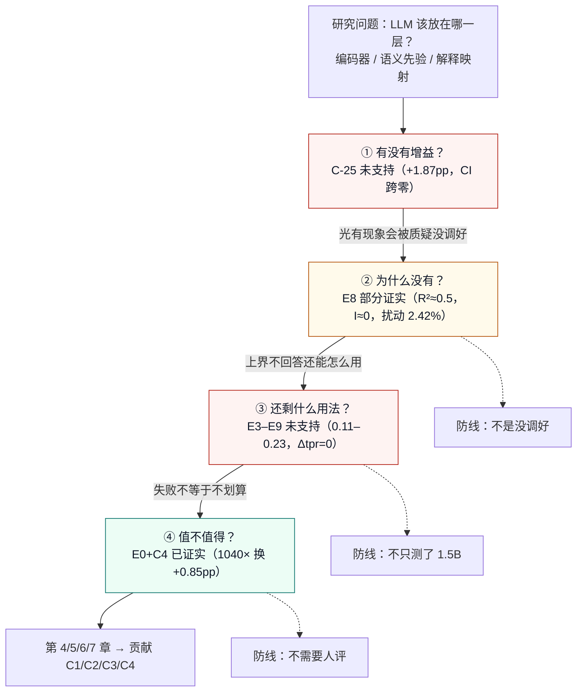

# 当前研究思路与论证链（2026-11-20）

> **本文性质**：解释性文档。回答"现在这篇论文到底在论证什么、为什么这样论证"。
> **配图**：`docs/figs/research-logic.png`（脚本 `docs/figs/make_research_logic.py`）
> **口径**：一切都以 `claims.md` v2.3 的状态为准；数字均可在 `results/2026-11-19|11-20/` 找到 `metrics.json`。


---

## 1. 一句话

**把「LLM 值不值」从一个"模型比较"问题，改造成四个可判定命题；并用"上界论证"代替"经验比较"。**

原来的做法是：训一个 LLM 主干，跟 BERT 比，谁高谁赢。这条路在 2026-11 被证伪两次（C-25 无增益、C-26 解释无增益），而且本质上不可判定：比输了也说不清是"模型不行"还是"没调好"。

现在的做法是：先证明**这条数据管线上不可能有增益**（信息论上界），再证明**剩下的用法也换不到标注**（三档编码器），最后用**成本**把结论钉在工程上（Pareto）。三个论证互相兜底，任何一个单独成立都不足以支撑论文。

---

## 2. 四个环节：问题 → 证据 → 判定 → 表述约束

| # | 问题 | 证据 | 判定 | 表述约束 |
|---|---|---|---|---|
| **1** | 有没有增益？ | `C-25`：A0\* − A3 = +1.87pp，t-CI [−8.85, +12.59] 跨零（5 seed，对齐 batch/epoch/pooling/adapter） | **未支持** | 只能写"无可检测增益"；CI 宽 21pp，实际只排除 >12.6pp → **禁止**写"LLM 无用" |
| **2** | 为什么没有？ | `E8.1` R² 0.498/0.691；`E8.2` −0.020 nats；`E8.3` 同类 2.42% vs 跨类 66.2%；检查1 9362/9362；**E10** 全 79 字段文本 R=0.059/0.013/−0.003（logreg/mlp/hgb），正例 R=0.168/0.065（CI>0） | **部分证实** | "文本无独立信息"成立（E8.1/E8.2 承担）；E10 排除"20 字段构造压低上界"，但正例未达 0.30 → 判据"方向可判、幅度不可跨估计器比较"；E8.4 −1.33pp 与容量混叠 → "文本可省"**不**成立 |
| **3** | 还剩什么用法？ | `E3` 0.1281/0.1462/0.1130（门槛 0.50）；`E4` α\*=0；`E5` ≤+0.44pp；`E6` +0.45pp；`E9` Δtpr=0 | **未支持** | 第 6 章降级为"边界内的尝试"，不再追加变体 |
| **4** | 值不值得？ | `E0` 0.9855/0.035ms；`A0*` 0.9940/36.36ms | **已证实** | 描述性；部署判据：检测走 79 维 MLP，映射交给检索（61/72，p=3.2e-4） |

---

## 3. 为什么必须是这个顺序（依赖关系）

```
① 现象（无增益）
    ↓ 光有现象不够 —— 会被质疑"没调好"
② 上界（不可能有增益）        ← H1 文本＝f(特征) + H2 数据处理不等式
    ↓ 上界只解释"为什么没用"，不回答"那还能怎么用"
③ 补救（语义先验）            ← 三档编码器 × 零样本/少样本/开集
    ↓ 补救也失败，但"失败"不等于"不值得"
④ 代价（成本-精度）            ← 1040× 换 +0.85pp
```

四个环节的**逻辑依赖**，而不是时间顺序：

- ①单独成立 → 只是一次失败的尝试；
- ②单独成立 → 只是理论，没有实证支撑"到底有没有增益"；
- ③单独成立 → 只是"另一种用法也不行"，读者会问"那到底差多少"；
- ④单独成立 → 只是工程测量，没有回答"为什么"。

四者合起来才是完整命题：**现象不可检测 → 机制决定不可能 → 剩余用法为零 → 成本上也不划算**。

---

## 4. 判定与表述的机制（这套思路最"硬"的地方）

三态判定 + 表述约束，是负结果能被相信的前提：

| 判定 | 允许表述 | 禁止表述 |
|---|---|---|
| **已证实** | 可直接陈述，须附效应量与 CI | — |
| **未支持** | "不支持 / 不可区分" | **禁止反向断言**（"LLM 无用""数值模态无效"） |
| **待检验** | 只能写"待检验" | 不得进摘要与标题 |

外加两条工程纪律：门槛**跑数前**写进 `claims.md`（C-28/29/30），跑完只判达标/未达标；任何产物须在 `artifacts/ledger.csv` 里 `active` 才算证据（144 份旧 OOD 报告因缺 `unknown_origin` 已降级）。

---

## 5. 三条预设防线

| 可能的质询 | 回应 |
|---|---|
| "是不是没调好？" | 用 H2 回答：换成任何编码器都不改变 `I(text;y)` 的上界，这不是调参问题；再用 C-19 公平对照（5 seed + 配对 bootstrap + 对齐 pooling/adapter）兜底 |
| "只测了 1.5B？" | E9 容量阶梯 110M→1.5B→7B：Δtpr = 0，AUROC 0.259→0.386→0.523（均接近随机）；只写"110M–7B 无增益"，不外推 API 模型 |
| "没人评怎么证明有用？" | 论文定位是识别而非解释；人评缺 38 行 → C-27 判"不确定"，不写成可交付；只报客观指标，人评明写为第 8 章边界 |

---

## 6. 三个未闭合点（写论文时必须处理）

| 位置 | 问题 | 处理方式 |
|---|---|---|
| 环节 1 | C-25 的 CI 宽 21pp，功效不足以支撑"无增益"的强表述 | 摘要只写"无可检测增益"；正文报 CI 宽度，不引申 |
| 环节 2 | E8.4 与 LLM 容量混叠（去掉文本也去掉了 Qwen1.5B+LoRA） | 已限定为"不能声称文本可省"；不反推"文本携带信息" |
| 环节 3 | E9 的 AUROC 随规模变化（0.259→0.386→0.523）可能是距离尺度伪影（E6 中 `P_rand` 的 tpr 高于热启动） | 只用"容量无效"这个判定，删掉"AUROC 变化 = H2 证据"的推论 |

### 6.1 C-25 的 seed 级诊断（探索性，**不得作为证据**）

逐 seed 复算 `results/2026-11-03/ood_multiseed_fair_encoder_n5.json`（A0\* 与 A3 同 backbone seed 配对，`tpr@fpr=1%`，单位 %）：

| backbone seed | A0\* | A3 | 配对差（A0\* − A3） |
|---|---|---|---|
| 42 | 9.09 | 1.04 | +8.05pp |
| 123 | 7.79 | 2.08 | +5.71pp |
| 456 | 8.31 | 5.19 | +3.12pp |
| **789** | 9.87 | **23.12** | **−13.25pp** |
| 1011 | 8.83 | 3.38 | +5.45pp |
| **全 5 seed** | 8.78 ± 0.79 | 6.96 ± 9.16 | **+1.82pp，CI[−8.86, +12.50]** |
| 去掉 789（仅诊断） | — | — | **+5.58pp，CI[+2.37, +8.79]** |

读法：A3 的 seed 间方差（sd 9.16pp）几乎全部来自 seed 789 一个点。它的存在把配对差从 +5.6pp 压到 +1.8pp 并使 CI 跨零；去掉它结论方向反转、CI 不含 0。

**三条约束**：

1. 事后剔除 seed 是**不合法**操作，不能作为"LLM 更好"的证据 —— 这一行只为说明**方差主导**，不产生任何 claim；
2. 它说明的是**设计分辨率不足**（噪声 8.6pp > 待检效应 2pp），不是 LLM 优于 BERT；
3. 正确修法是加 seed（要检出 2pp 约需 147 个），不是删 seed。

写作处置：把"A3 的 seed 间方差主导比较"写进 Limitations 并附逐 seed 表；摘要继续只写"无可检测增益"。

---

## 7. Mermaid 源码


